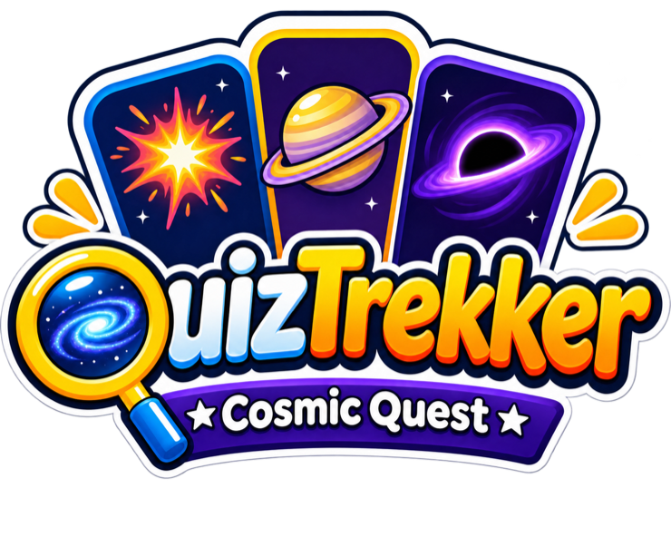

<p align="center">
  
</p>
<p align="center">
  <a href="https://natsteff.github.io/quiztrekker-cosmic-quest/">
    
  </a>
</p>

# QuizTrekker: Cosmic Quest

**Current release · v0.14.3**

Explore the Solar System and the science beyond it with illustrated flashcards, an interactive orbit map, and quizzes. On your first visit, a welcome screen explains the beginner setup: **Foundations** with **Solar System Basics** enabled. Start with the Sun, eight planets, and Earth’s Moon. Use Settings to add more moons, dwarf planets, and topics like black holes and time dilation, or switch to **Advanced** questions.

## Add Cosmic Quest to your Home Screen

1. Open [Cosmic Quest](https://natsteff.github.io/quiztrekker-cosmic-quest/) on your phone.
2. **iPhone:** In Safari, tap **Share**, choose **Add to Home Screen**, turn on **Open as Web App** if shown, then tap **Add**.
3. **Android:** In Chrome, tap **⋮**, choose **Add to Home screen**, then follow the **Create shortcut** or **Install** option shown.
4. Tap the **QT Cosmic Quest** icon on your Home Screen to open the game.

The first-visit welcome also shows these steps on supported phones and tablets. An internet connection is required.

## Play on a TV

[Open Cosmic Quest in TV layout](https://natsteff.github.io/quiztrekker-cosmic-quest/?fullscreen=1) for larger text and controls and a Learn view focused on cards. Open the regular game link to return to the standard layout.

To also hide browser controls on a computer running Chromium, launch it in kiosk mode.

```sh
chromium --kiosk "https://natsteff.github.io/quiztrekker-cosmic-quest/?fullscreen=1"
```

## Play with a controller

Connect a controller and press and release a button while the game is focused. Standard-mapped controllers work in the regular game and TV layout. The on-screen guide uses Xbox-style button names. Use LB and RB to switch tabs, Menu for Settings, and View to return to the game list during Play. For short answer lists, press the button shown next to an answer. For planet ordering and longer lists, highlight a choice with the D-pad or left stick and press A. Use the right stick to scroll.

Open **Settings → Controller controls** to see the device status, preview the guide, or assign buttons and axes. Unmapped controllers require the explicit fallback setting. A controller that emulates a keyboard will only appear as a gamepad if the browser exposes it through the Gamepad API.

## How to play

- **Learn** — Tap a planet’s quick facts to compare all eight planets. Scan illustrated card fronts for key facts, then flip for details and size comparisons. Short image credits open the full sources and usage terms in Settings. Open the **Explorer** to browse orbits and moon systems, see distances on a linear scale, or compare worlds by size.
- **Play** — Try Space Quiz, Planet Order, Match the Moon to Its Planet, Image Identification, Planet Size, or Orbital Distance. Round results show correct answers and points earned. Moon matching requires the other moons pack to be enabled for practice.
- **My Progress** — See your points, explored and mastered cards, correct answers, and best streak. The Learn progress bar switches to mastery after you mark a card as mastered. The game saves progress in your current browser.
- **Settings** — Use the gear to add content packs, switch between Foundations and Advanced, or leave familiar topics out of practice while keeping their cards in Learn. The game checks for new releases when it opens or returns to the foreground. Use **Check for updates** to check on demand. An unfinished quiz stays open, and saved progress carries over.

## Learn artwork and sources

- The black star field uses a filtered crop of the Milky Way survey image. ESO and Digitized Sky Survey 2. Acknowledgment: Davide De Martin and S. Guisard ([www.eso.org/~sguisard](https://www.eso.org/~sguisard)). [Image source](https://www.eso.org/public/images/eso0949l/) · [CC BY 4.0](https://www.eso.org/public/copyright/)


- Saturn is a color- and contrast-enhanced Cassini image credited to NASA/JPL/Space Science Institute. [Image source](https://science.nasa.gov/image-detail/pia05380-saturn-with-rings-16x9/) · [JPL image use policy](https://www.jpl.nasa.gov/jpl-image-use-policy/)
- The Crab Nebula is a Webb infrared composite credited to NASA, ESA, CSA, STScI, and Tea Temim (Princeton University), with image processing by Joseph DePasquale (STScI). The bundled JPEG is resized and re-encoded. [Image source](https://science.nasa.gov/asset/webb/crab-nebula-nircam-and-miri-image/) · [STScI content use policy](https://www.stsci.edu/copyright)
- The black hole is a visualization credited to NASA’s Goddard Space Flight Center/Jeremy Schnittman. [Visual source](https://svs.gsfc.nasa.gov/13326/) · [NASA SVS usage guidance](https://svs.gsfc.nasa.gov/help/)
- The planetary scale, light-year, time dilation, and expansion diagrams were drawn for Cosmic Quest.

The expanded Solar System cards show their individual [NASA Photojournal](https://science.nasa.gov/photojournal/) credits and source links beside each image. Resized JPEGs keep the game lightweight. Haumea pairs Kevin M. Gill’s artist’s impression with a Hubble observation in **More facts**. [Artist’s impression and CC BY 2.0 license](https://commons.wikimedia.org/wiki/File:Haumea_with_rings_(37641832331).jpg) Makemake and Eris use credited artist’s concepts. The Asteroids card shows the OSIRIS-REx mosaic of Bennu.

The Comets card uses a resized photograph of Hale–Bopp by E. Kolmhofer and H. Raab, Johannes-Kepler Observatory. [Image source](https://science.nasa.gov/asset/webb/comet-hale-bopp-johannes-kepler-observatory/) · [CC BY-SA 3.0](https://creativecommons.org/licenses/by-sa/3.0/)

Planet Size uses equatorial diameters. Orbital Distance compares orbital semimajor axes around the Sun. [NASA Planetary Fact Sheet](https://nssdc.gsfc.nasa.gov/planetary/factsheet/index.html)
